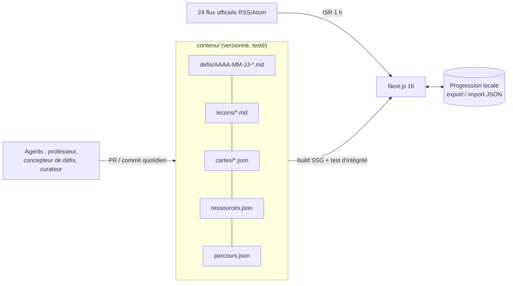

<div align="center">

# Socle

**On progresse en résolvant.**

Un défi réel par jour en DevOps, data engineering ou full stack — à résoudre avant minuit, chrono en main.
Des fiches terrain pour s'appuyer, la révision espacée pour retenir, et le fil d'actualité des sources officielles.

[](https://nextjs.org) [](#qualité) [](LICENSE)

</div>

---

## Pourquoi

Les tutoriels apprennent à suivre des instructions. Le métier demande autre chose : diagnostiquer un
conteneur qui meurt la nuit, une requête qui passe de 50 ms à 30 s, un pipeline qui retraite deux fois les
mêmes données. Socle entraîne à **ça**, un peu chaque jour.

## Une journée

| | |
|---|---|
| **Le défi** | Une situation d'entreprise avec ses vraies pièces (logs, Dockerfile, EXPLAIN, DAG, workflow CI…). Chrono lancé, hypothèses horodatées, trois indices (−10 points chacun), solution soumise et **figée**, puis correction et auto-évaluation sur des critères vérifiables. |
| **La fiche** | Une notion du parcours, choisie en alternant les pistes, avec une pratique sur ta machine. |
| **La révision** | Les cartes des fiches terminées reviennent juste avant d'être oubliées (SM-2). Clavier : `espace`, `1`–`4`. |
| **Le fil** | 24 flux **officiels** : Kubernetes, Docker, CNCF, AWS, Google Cloud, Azure, HashiCorp, Grafana, Cloudflare, PostgreSQL, Airflow, dbt, DuckDB, GitHub, Node.js, Next.js, React, TypeScript, Rust, Go, Hugging Face, CERT-FR (ANSSI), CNIL. |
| **Les ressources** | Une bibliothèque de ressources gratuites, officielles d'abord, qui grandit avec les défis. |

La méthode (apprentissage par problème, rappel actif, révision espacée, entrelacement, Feynman, pratique délibérée) est expliquée et sourcée dans l'application : `/methode`.

## Architecture



```
src/domaine/   srs (SM-2), programme (entrelacement), progression, défis (chrono, score), flux RSS/Atom — pur, testé
src/lib/       chargement du contenu, test d'intégrité du contenu réel, fil, rendu markdown + coloration au build
src/app/       aujourd'hui, défis, fiches, réviser, fil, ressources, méthode
contenu/       le savoir lui-même : un défi par jour, des fiches, des cartes, des ressources
```

Le contenu est du code : chaque ajout passe le **test d'intégrité** (`src/lib/contenu.test.ts`) — schéma, liens
entre fiches, cartes orphelines, doublons, un défi par date. Un ajout qui casse quelque chose n'est pas publié.

## Démarrer

```bash
npm install
npm run dev
npm test && npm run typecheck && npm run lint && npm run build
```

Aucune variable d'environnement, aucune base de données, aucun service payant.

## Qualité

Domaine couvert par Vitest, TypeScript strict, ESLint, accessibilité (clavier, `aria-*`, `prefers-reduced-motion`),
responsive dès 375 px, aucun HTML brut dans le contenu.

---

Conçu et construit par **[Raoul Bonsso](https://github.com/RaoulBonsso)** — développeur full stack & DevOps.
